# Matrix bench

A browser simulator for a 32×32 RGB LED matrix. The registered projects are [pacmanclock](https://github.com/clogwog/pacmanclock), [pongclock](https://github.com/clogwog/pongclock), [matrixclock](https://github.com/clogwog/matrixclock), [tetrisclock](https://github.com/clogwog/tetrisclock), [plasmaclock](https://github.com/clogwog/plasmaclock), [snakeclock](https://github.com/clogwog/snakeclock), [marioclock](https://github.com/clogwog/marioclock), [gameoflifegame](https://github.com/clogwog/gameoflifegame), [dancemonkey](https://github.com/clogwog/dancemonkey), and [rexie](https://github.com/clogwog/rexie). The page loads each program’s C++ and runs it on a virtual panel of round, glowing pixels. Clocks use this computer’s local time.

The live demo is [clogwog.net/projects/panel-player](https://clogwog.net/projects/panel-player/).

- [Pac-Man Clock](https://clogwog.net/projects/panel-player/?project=pacmanclock)
- [Pong Clock](https://clogwog.net/projects/panel-player/?project=pongclock)
- [Matrix Clock](https://clogwog.net/projects/panel-player/?project=matrixclock)
- [Tetris Clock](https://clogwog.net/projects/panel-player/?project=tetrisclock)
- [Plasma Clock](https://clogwog.net/projects/panel-player/?project=plasmaclock)
- [Snake Clock](https://clogwog.net/projects/panel-player/?project=snakeclock)
- [Mario Clock](https://clogwog.net/projects/panel-player/?project=marioclock)
- [Game of Life](https://clogwog.net/projects/panel-player/?project=gameoflifegame)
- [Dance Monkey](https://clogwog.net/projects/panel-player/?project=dancemonkey)
- [Rexie](https://clogwog.net/projects/panel-player/?project=rexie)

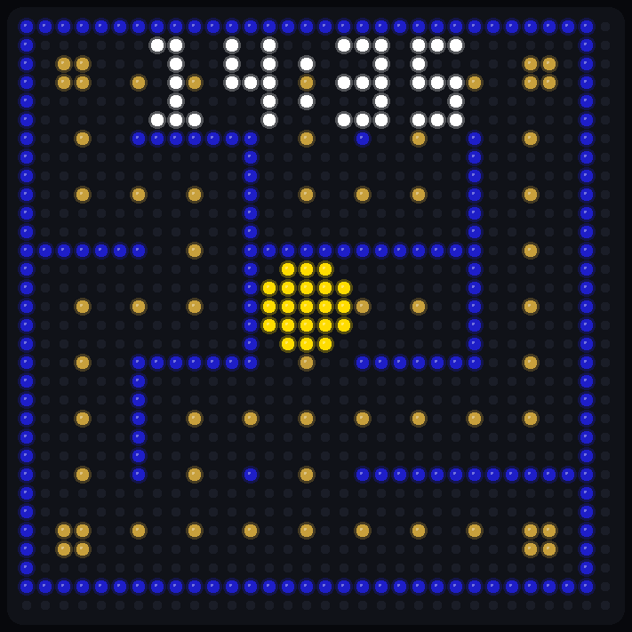

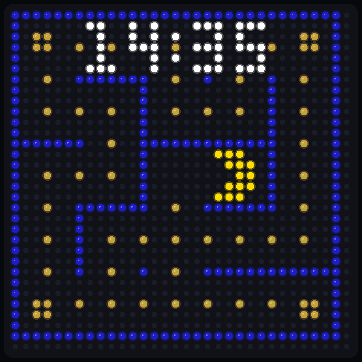

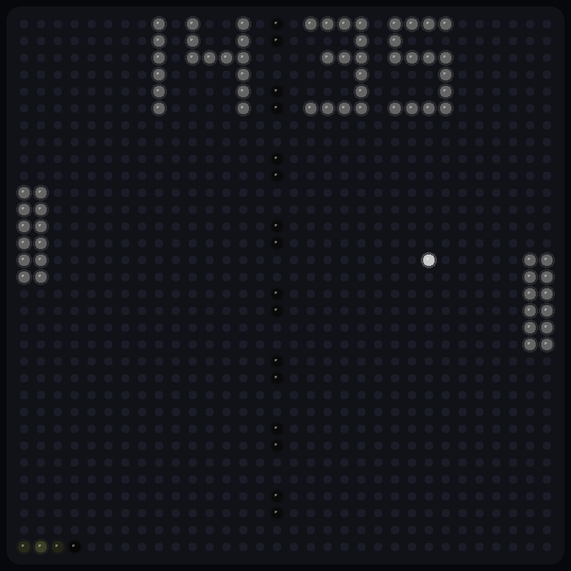

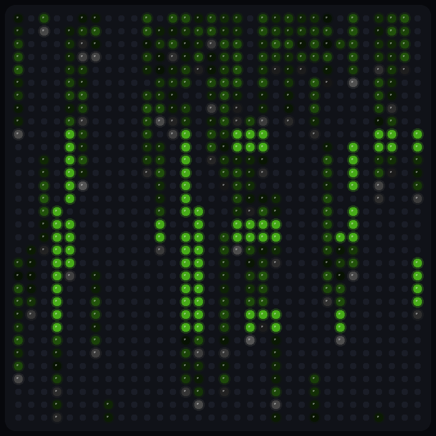

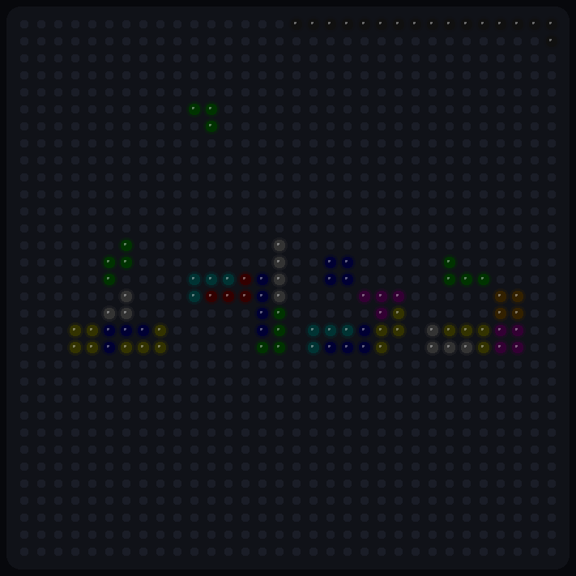

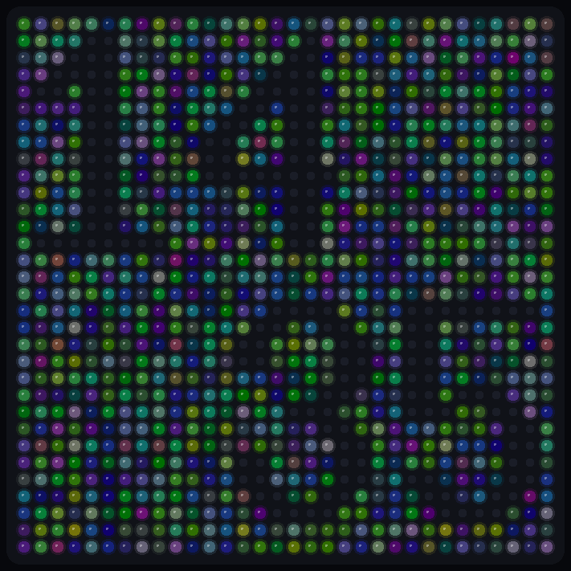

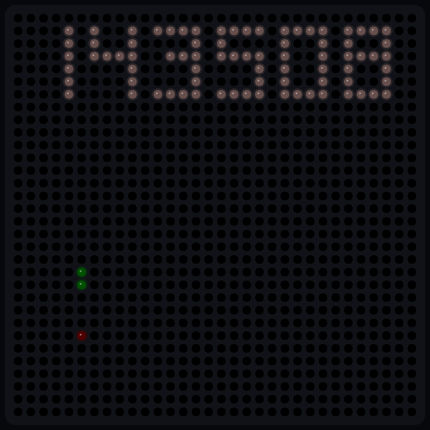

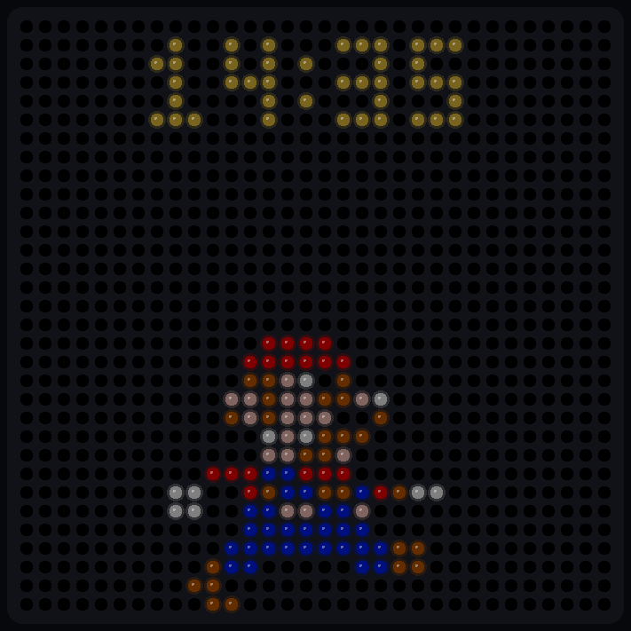

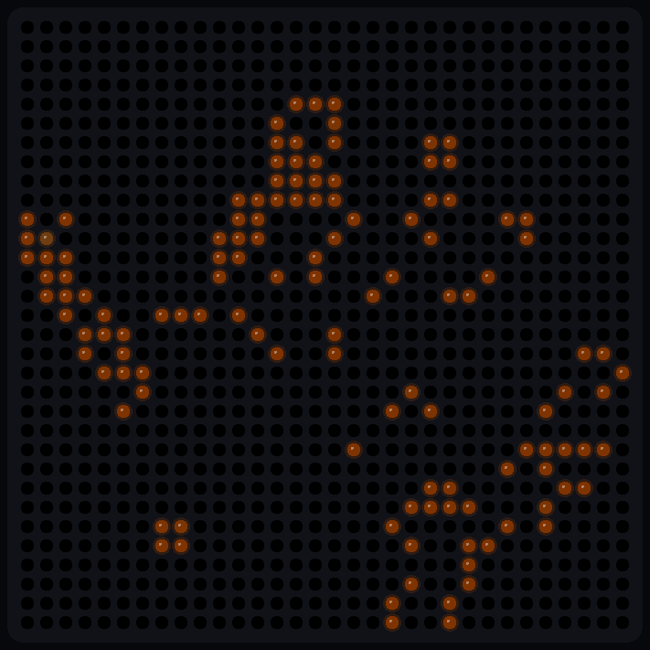

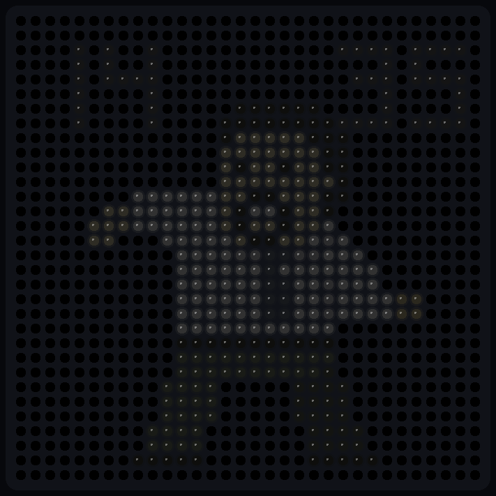

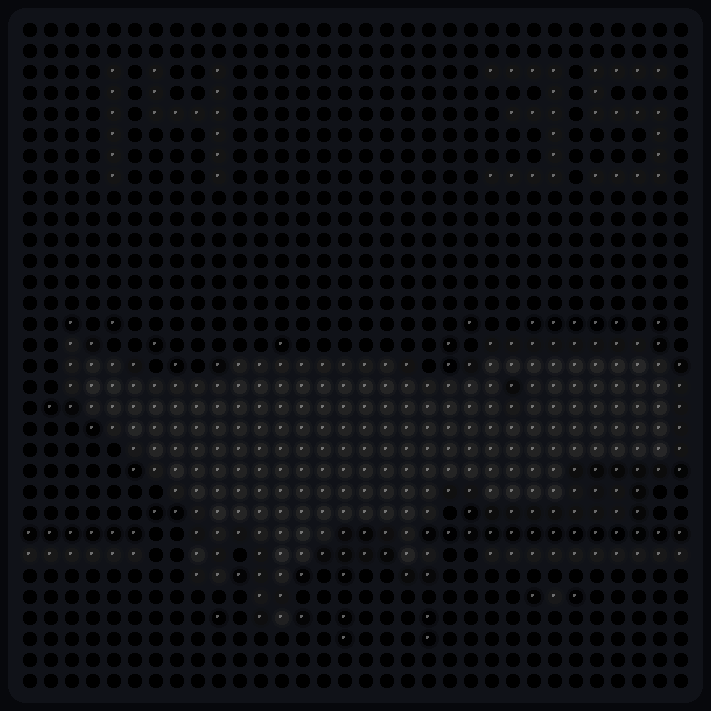

## Run it

The site is static. ES modules will not load from a `file://` URL, so use a local static server from the repo root:

```bash
npm start
```

Then open `http://127.0.0.1:8080/`. `npm start` is `python3 -m http.server 8080`. Any other static server works the same way. Asset URLs are relative (`css/app.css`, `src/main.js`, and the loaders’ `import.meta.url` fetches), so the same tree also works under a subpath such as `https://clogwog.net/projects/panel-player/`.

The page reads a `project` query parameter. These open a project directly:

- `?project=pacmanclock`
- `?project=pongclock`
- `?project=matrixclock`
- `?project=tetrisclock`
- `?project=plasmaclock`
- `?project=snakeclock`
- `?project=marioclock`
- `?project=gameoflifegame`
- `?project=dancemonkey`
- `?project=rexie`

`?brightness=` is optional and runs from 0 to 160. 0 shows the raw `SetPixel` bytes. Above 0, the strongest channel is lifted (100 is the sRGB step, 140 the default, 160 the top) and the other channels follow the RGB-matrix CIE1931 curve, the same curve `SetPixel` applies before PWM. That keeps a pastel sprite’s hue. Tetris (channels near 51), Pong digits (100), Pong’s centre dashes (10), Plasma (scaled by 0.5), Snake (body 80, clock at HSV value 0.4), Mario (every channel multiplied by 0.5), Game of Life (channels scaled by 0.5), Dance Monkey, and Rexie (sprite scaled by 0.2, clock ink at 20) still brighten with the slider. 255 stays full, so Pac-Man and Matrix do not clip. An off LED is black and has no centre dot, so it is never lighter than a dim lit one. The Screen slider remembers the choice in `localStorage`.

A missing or unknown project starts Pac-Man Clock, the same project as a visit with no query. Other parameters stay on the URL. The first load uses `history.replaceState` so the address names the running project. Choosing an icon uses `history.pushState`, which keeps the link shareable and lets Back return to the previous project. The path is whatever page you opened, including `/projects/panel-player/`.

Those URLs carry `?v=` from `BUILD_VERSION` in `src/version.js` (the CSS link, every relative module import, and each fetched `.cc`, `.h`, and `.bdf`). A CDN that keeps brotli for days then fetches the new file instead of the previous one. After changing `BUILD_VERSION`, run `node scripts/stamp-version.js` so the query strings match the constant. `npm test` checks that they do. Node strips the query while resolving modules; browsers keep it as a cache key.

```bash
python3 -m http.server 8080
```

There is no build step. Nothing here drives a physical HAT or a Raspberry Pi. GPIO, syslog, and `SwapOnVSync` are host stubs; the visible panel is the browser canvas.

## Tests

Node’s built-in test runner is enough. No extra packages.

```bash
npm test
```

The tests cover the preprocessor (digit macros, include guards), a small interpreted drawing program (integer division, reference parameters, `SetPixel`), default arguments and in-class initializers, the `?project=` parser (the clock ids, unknown values, and a subpath that keeps its other parameters), pacmanclock (parsed colours, the 3×5 digit tables, the right-facing mouth sprite, a 14:35 frame, and movement after the 80&nbsp;ms step), pongclock (a 14:35 frame with BDF digits, centre dashes, the second-hand row, paddles, and a ball that moves on the next `usleep`), matrixclock (digits still 0 for 14 frames, then 14:35 on the 15th, with the rain moving and a full-green mask pixel once a streak crosses a digit), tetrisclock (17 grey second-frame pixels at 14:35:08, then falling tetrominoes that land on later frames), plasmaclock (the 14:35 glyphs from `10x20.bdf` are black, the rest of the panel is plasma, and the next frame moves), snakeclock (a 14:35:08 frame with one red apple, a green snake, and time pixels that are neither), marioclock (gold 14:35 at the first frame, Mario’s hat on the panel after 138 steps, then the minute digit 6 after the clock jumps to 14:36), gameoflifegame (531 orange cells at the seeded 14:35:08 start, then a later frame that is no longer only that orange), dancemonkey (141×3072 sprite rows, grey 14:35 and a skin pixel on the first frame, a changed second frame, and `done` after the two passes), and rexie (80×3072 sprite rows, grey 14:35 and a `(34, 34, 34)` body pixel on the first frame, a changed second frame, and `done` after the two passes).

Regenerate the README pictures with:

```bash
npm run preview
```

## GitHub Pages

`.github/workflows/pages.yml` publishes `index.html`, `css/`, and `src/` to GitHub Pages on pushes to `main`. Turn on Pages with the source set to **GitHub Actions**. The preview appears after that workflow runs on `main`; a pull request does not deploy by itself.

## Layout

| Path | Role |
| --- | --- |
| `src/cpp/` | Preprocessor, parser, and interpreter for the C++ subset |
| `src/matrix/` | Shared `VirtualMatrix`, local clock, and bitmap font |
| `src/render/panel-view.js` | 32×32 glowing-dot canvas |
| `src/projects/registry.js` | Project list behind the icon grid |
| `src/projects/url.js` | `?project=` parsing and shareable URLs |
| `css/thumbs/` | Square LED previews for the project icons |
| `src/projects/pacmanclock/` | Vendored Pac-Man Clock sources, system stubs, adapter |
| `src/projects/pongclock/` | Vendored Pong Clock sources, font, system stubs, adapter |
| `src/projects/matrixclock/` | Vendored Matrix Clock sources, digit masks, font, system stubs, adapter |
| `src/projects/tetrisclock/` | Vendored Tetris Clock sources, piece tables, system stubs, adapter |
| `src/projects/plasmaclock/` | Vendored Plasma Clock sources, 10×20 font, system stubs, adapter |
| `src/projects/snakeclock/` | Vendored Snake Clock sources, digit font, system stubs, adapter |
| `src/projects/marioclock/` | Vendored Mario Clock sources, sprite tables, system stubs, adapter |
| `src/projects/gameoflifegame/` | Vendored Game of Life sources, digit font, system stubs, adapter |
| `src/projects/dancemonkey/` | Vendored Dance Monkey sources, sprite header, digit font, system stubs, adapter |
| `src/projects/rexie/` | Vendored Rexie sources, sprite header, digit font, system stubs, adapter |
| `src/matrix/bdf.js` | BDF loader used by the host `DrawText` |
| `index.html` | The bench UI |

`VirtualMatrix` is the shared pixel buffer (`SetPixel`, `Clear`, `Fill`). `createClock()` is the shared time source (`time`, `localtime`, `localtime_r`, `gettimeofday`). `BitmapFont` is the shared glyph drawer for a future project written in JavaScript. Pac-Man Clock does not call `BitmapFont`; its digits are the `bool` tables in `digit.cc`, drawn by the interpreted `Digit::hittest`. Pong Clock’s digits come from `pongnumberfont.bdf` through the host `rgb_matrix::DrawText`. Matrix Clock loads that same BDF so `main` continues, and draws its digits from the `bool` masks in `number.cc`. Plasma Clock draws the hour and minute with `10x20.bdf` through the same host `DrawText`, in black, on top of the plasma. Snake Clock draws `HH:MM:SS` with `pongnumberfont.bdf`. Mario Clock draws `HH:MM` from the `const char*` digit tables in `marioclock.cc` and the Mario walk from the sprite tables in the same file. Game of Life loads `pongnumberfont.bdf` and does not draw with it. Dance Monkey draws `HH:MM` with that font on top of the `brent.h` frames. Rexie draws `HH:MM` with that font on top of the `rexieanimation.h` frames.

## Adding a project

1. Create `src/projects/<id>/adapter.js` exporting an object with `id`, `title`, `description`, and `async start(host)`. `repo`, `shows`, and `thumb` fill the sidebar link, the hover card, and the icon (`thumb` is a page-relative path such as `css/thumbs/<id>.png`).
2. Register it in the array inside `src/projects/registry.js`. The id is also the `?project=` value.
3. From `start`, call `host.onFrame(frame)` with `{ width, height, pixels, brightness }`. `pixels` is a `Uint8ClampedArray` of packed RGB, length `width * height * 3`, row-major, origin at the top left.
4. Use `host.clock.now()` for wall time, `host.schedule` / `host.cancel` to pace frames, and `host.paused()` if the bench pause button should freeze the sim.

`host` is the bench, not a matrix driver. A project can draw with `VirtualMatrix` directly, or it can compile C++ through `compileSources` and `createSession` when the source stays inside the subset below.

```javascript
import { VirtualMatrix } from "../../matrix/virtual-matrix.js";
import { MatrixProject } from "../project.js";

export class SolidProject extends MatrixProject
{
    constructor()
    {
        super({
            id: "solid",
            title: "Solid",
            description: "One lit pixel so the registry has a second entry."
        });
    }

    async start(host)
    {
        const matrix = new VirtualMatrix(32, 32);
        let timer = 0;
        let stopped = false;
        const tick = function ()
        {
            if (stopped || (host.paused && host.paused()))
            {
                timer = host.schedule(tick);
                return;
            }
            matrix.clear();
            matrix.setPixel(1, 1, 255, 220, 0);
            host.onFrame(matrix.snapshot());
            timer = host.schedule(tick);
        };
        timer = host.schedule(tick);
        return {
            stop()
            {
                stopped = true;
                host.cancel(timer);
            }
        };
    }
}
```

To reuse the interpreter, put the `.cc` sources and any stub headers in that project folder, build a `Map` of filename to text (see `load.js`), and pass the entry files to `compileSources`. `createSession(program, { clock, files }).step(nowMs)` runs until the next frame. Pac-Man Clock yields at `SwapOnVSync`. Pong Clock and Matrix Clock yield at `usleep`. Pass the same file map as `files` when the program calls `LoadFont` on a path such as `./pongnumberfont.bdf`.

## Interpreter trade-off

pacmanclock is ordinary C++: globals, a couple of classes, 2D `bool` tables, `vector`, `rand`, and `Canvas::SetPixel`. It does not use the RGB-matrix font renderer. Two ways to show it:

- **Hand-port the maze and the sprite to JavaScript.** Faster and easier to debug. The port is a second program, and it drifts the moment the C++ changes.
- **Interpret a C++ subset and execute the vendored sources.** The maze rules, colours, glyph tables, chomp timing, and `main` loop stay in `pacmanclock.cc` and `digit.cc`. The cost is a bespoke engine and a frame time around 20&nbsp;ms in Node, which is enough for the 80&nbsp;ms step but is not a general C++ compiler.

This repo takes the second path. Hardware from [rpi-rgb-led-matrix](https://github.com/hzeller/rpi-rgb-led-matrix) is not interpreted. Those headers in upstream are GPL-2; this tree replaces them with empty stubs and implements `SetPixel`, `Clear`, `CreateFrameCanvas`, and `SwapOnVSync` on `VirtualMatrix`. Pac-Man Clock publishes a frame at `SwapOnVSync`. Pong Clock and Matrix Clock draw on the `RGBMatrix` itself, so `usleep` publishes the live canvas. The host also implements the BDF slice of `Font::LoadFont`, `Font::baseline`, and `DrawText` that Pong Clock calls. Matrix Clock only needs `LoadFont` to succeed. The library sources are not vendored.

`rand` is a small 15-bit LCG, not glibc’s generator, so two runs with the same seed still will not match a Pi binary. `RAND_MAX` in the Pong Clock and Matrix Clock stubs is 32767 so it matches that generator. `srand(time(NULL))` is honoured, so each visit gets a new maze, a new ball, or a new set of streaks.

## What pacmanclock does here

Interpreted from the current upstream sources:

- 5×5 randomised DFS maze, plus the extra random edges
- Blue wall outline around corridor cells
- Pellets at cell centres and open midpoints
- 2×2 power pellets on the four corner cells
- Rainbow pellet flash for 0.35&nbsp;s after a power pellet
- 5×5 Pac-Man, directional mouth, chomp each step, no-backtrack wandering
- New maze when every pellet is gone
- White HH:MM, 3×5 digits from `digit.cc`, colon at (15, 2) and (15, 4)
- Step about every 80&nbsp;ms of wall time
- Local hour and minute (`localtime`), 24-hour

The picker is the registry. Pac-Man Clock, Pong Clock, Matrix Clock, Tetris Clock, Plasma Clock, Snake Clock, Mario Clock, Game of Life, Dance Monkey, and Rexie are registered.

## What pongclock does here

Interpreted from the current upstream sources:

- Left paddle at column 0 and right paddle at column 30, each a short vertical pair of lines
- Ball with a random start and direction, bouncing off the top and bottom
- Paddles track the ball, and deliberately miss when the hour or minute is due to change
- Hour and minute as two digits from `pongnumberfont.bdf`, grey `(100,100,100)`, hour at x=4 and minute at x=16
- Old digits are redrawn in black when that side scores
- Dashed centre line at x=15, colour `(10,10,10)`
- Second hand: a normal distribution along y=31, colour shifting from aqua toward orange by the hour
- One physics step per `usleep(25000)`. The bench waits about 25&nbsp;ms of wall time between steps
- Local time (`localtime` / `gettimeofday`), 24-hour, with a leading zero

## What matrixclock does here

Interpreted from the current upstream sources:

- Falling streaks, at most four in each of the 32 columns
- A new streak in column `t` when that column has room and `t == rand() % 64`
- Random height from 3 to 15, speed from 0.1 to 0.5, and a per-row strength from 50 to 89
- Body pixels fade green `(70, 170, 24)` toward black by that strength. The head fades white `(170, 170, 170)` the same way
- The cell just behind a streak is cleared
- Four 8×16 digit masks from `number.cc`, at x = 0, 8, 17, and 25, y = 9
- A mask cell that a streak crosses is drawn in the full green
- Digits stay 0 until the 15th frame, then follow the local hour and minute, and refresh every 15 frames after that
- `LoadFont("./pongnumberfont.bdf")` has to succeed. Nothing draws with that font
- One frame per `usleep(25000)`. The bench waits about 25&nbsp;ms between steps
- `shared_ptr<Rune>` is the `Rune` object itself, held in `vector<shared_ptr<Rune>> runes[32]`

## What tetrisclock does here

Interpreted from the current upstream sources:

- The time string `"HHMM"` is handed to `setText`. Each character is a falling tetromino sequence from `TetrisLetters.h`
- Pieces drop one row per frame, rotate on the way down, and stay where `y_stop` says
- Colours are the nine tetris colours scaled by `brightness` 0.2, so a full channel is 51
- A dim grey `(16,16,16)` second frame walks the border. At 14:35:08 that is 17 pixels, starting at the top from x=16
- One frame per `usleep(125000)`. The bench waits about 125&nbsp;ms between steps
- `drawNumbers` and the colon are in the library and are not called from `main`
- Added to the subset for this clock: `typedef struct { ... } Name`, a constructor initializer `field(arg)`, `string` addition, `substr`, and `string[i]` as a character code. Default arguments on the declaration stay when the out-of-line definition leaves them off. An `int` initializer truncates

## What plasmaclock does here

Interpreted from the current upstream sources:

- Every pixel is a plasma sample. `sec` starts at 0 and grows by 0.001 each frame
- `sin`, `cos`, `fabs`, and `sqrt` drive the colour. Brightness 0.5 scales the channels, then they are stored as `int`
- `pi` is `M_PI` from the math stub
- Hour at baseline y=14, x=0, and minute at baseline y=30, x=12, both from `10x20.bdf`, drawn in black so the time is a hole in the plasma
- `DrawText` sits in the column loop, so the digits are painted once per column. The finished frame is the full field with black digits
- One frame per `usleep(100000)`. The bench waits about 100&nbsp;ms between steps
- Added to the subset for this clock: `sin`, `cos`, `sqrt`, and `fabs`

## What snakeclock does here

Interpreted from the current upstream sources:

- The snake starts as one green cell `(0, 80, 0)` at the centre. The apple starts on that same cell, red `(80, 0, 0)`, so the first frame moves the apple and the snake grows
- Each later frame drops the tail unless the head is on the apple, then steps one cell toward the apple. It will not reverse, and it stops at the edge instead of wrapping
- `HH:MM:SS` comes from `pongnumberfont.bdf`. The string is measured with an off-screen `DrawText`, then drawn from the right with a 3-pixel margin. The font has no colon, so the glyphs are the six digits
- The clock colour is HSV with value 0.4. Hue swings from red to green over 12 seconds, and saturation dips through white
- One frame per `usleep(200000)`. The bench waits about 200&nbsp;ms between steps
- Added to the subset for this clock: `deque` (`push_front`, `front`), a `struct` constructor with `: field(arg)`, `static_cast`, `fmod`, `floor`, `sinf`, `cosf`, `strftime` (`%H`, `%M`, `%S`), `localtime_r`, a lambda with `[&]` and a trailing return type, and `for (const Point &p : deque)`. The 8-argument `DrawText` reads the text from the seventh argument and adds the letter spacing

## What marioclock does here

Interpreted from the current upstream sources:

- `HH:MM` is 3×5 digits from the `DIGITS` tables, coin gold `(240, 200, 60)`, then multiplied by `DIM_FACTOR` 0.5, so the panel sees `(120, 100, 30)`. The block starts at x=7, y=1
- Mario is a 15×15 walk of four frames from the `MARIO` tables. Red, peach, brown, blue, and white are halved the same way. Black (`K`) stays off
- He enters from the left at x=-15, y=17, steps every 6 ticks, leaves on the right, waits, then mirrors and walks back
- When the minute changes, the old time stays until he is at x=13. He jumps to y=6, the minute digits fly off the top, hide, and the new minute falls back. He keeps the direction he had
- One frame per `usleep(25000)`. The bench waits about 25&nbsp;ms between steps
- Added to the subset for this clock: `enum`, `const char*` sprite tables (indexing a string yields a character code), reference parameters, `static inline`, a lambda with `[]`, and chained assignment `r = g = b = 0`

## What gameoflifegame does here

Interpreted from the current upstream sources:

- `srand(time(NULL))` seeds the 15-bit LCG, then `rand() % 150 + 30` is the frame delay. At 14:35:08 that delay is 95, and `cout` prints `speed 95`
- The 32×32 field starts as `rand() % 2`. A live cell is orange `(127, 51, 0)` at age 0, half of cyan `(0, 255, 255)` blended toward orange `(255, 102, 0)` by age, then halved again
- A cell with fewer than 2 or more than 3 neighbours dies. A dead cell with 3 neighbours is born. Age climbs to 255 while a cell stays alive
- Every 100 frames the population sum is compared with the next frame. A match, or frame 10000, refills the field at random
- `LoadFont("./pongnumberfont.bdf")` has to succeed. Nothing draws the time
- One frame per `usleep(1000 * animationSpeed)`. The bench waits about 75&nbsp;ms between steps
- `crNum` is `((x)+(y))%z`. A negative remainder stays negative, and a read off the array is 0, so the rim is not a torus
- Added to the subset for this program: a ternary whose branches assign (`cell ? isAlive = true : isAlive = false`), a `for` whose step is the write and whose body is empty, a `for` whose step only increments, and `cout << ... << endl`

## What dancemonkey does here

Interpreted from the current upstream sources:

- `brent.h` is 141 frames of 32×32 RGB, `const uint8_t animation_icons[][bmsize]` with `bmsize` `(32 * 32 * 3)`. The first dimension is taken from the brace list
- Between 07:00 and 22:00 the sprite scale is 0.2 and the clock ink is `(20, 20, 20)`. Outside that the scale is 0.1 and the ink is `(10, 10, 10)`. The frame stores those truncated bytes. Skin `(232, 224, 184)` is `(46, 44, 36)` on the matrix. The screen paints that triple with CIE1931, so it stays tan `(142, 138, 119)` at the default slider instead of the per-channel grey `(142, 140, 131)`
- `DrawIcon` repaints a pixel only when its RGB differs from the previous frame. Frame 0 paints the whole picture
- `HH` is drawn at baseline y=8, x=0, and `MM` at x=21, both from `pongnumberfont.bdf`. A one-digit hour or minute is padded with `insert(0, 1, '0')`
- `time_t t` is sampled once, before the loops, so the digits stay on that minute
- The animation plays twice (`repeat <= 1`), then `main` returns. That is 282 frames, and the next step reports the program finished
- One frame per `usleep(100000)`. The bench waits about 100&nbsp;ms between steps
- Added to the subset for this program: an unsized outer dimension on a 2D array, a parameter `const uint8_t icons[][bmsize]`, and the same `cout` stream on the font-failure branch

## What rexie does here

Interpreted from the current upstream sources:

- `rexieanimation.h` is 80 frames of 32×32 RGB, `const uint8_t animation_icons[][bmsize]` with `bmsize` `(32 * 32 * 3)`. The first dimension is taken from the brace list
- Between 07:00 and 22:00 the sprite scale is 0.2 and the clock ink is `(20, 20, 20)`. Outside that the scale is 0.1 and the ink is `(10, 10, 10)`. A grey body byte `172` is stored as `(34, 34, 34)`
- `DrawIcon` repaints a pixel only when its RGB differs from the previous frame. Frame 0 paints the whole picture
- `HH` is drawn at baseline y=8, x=0, and `MM` at x=21, both from `pongnumberfont.bdf`. A one-digit hour or minute is padded with `insert(0, 1, '0')`
- `time_t t` is sampled once, before the loops, so the digits stay on that minute
- The animation plays twice (`repeat <= 1`), then `main` returns. That is 160 frames, and the next step reports the program finished
- One frame per `usleep(150000)`. The bench waits about 150&nbsp;ms between steps
- The same subset as Dance Monkey covers this program. No new C++ constructs were required

## What is not simulated

- A general template system. The subset knows `vector<T>`, `deque<T>` (the same object, plus `push_front` and `front`), `shared_ptr<T>` as the object itself (no control block or `use_count`), `make_shared<T>(...)`, and `vector::begin` / `erase` combined with iterator `+`. A `>>` token can close two template argument lists
- Inheritance, virtual calls, exceptions, and general operator overloading. `cout << value << endl` appends to a host stream (`cout`, `cerr`, `clog`, and the `std::` names, plus `endl`). Namespaces are not scopes. Lambdas are `[]` or `[&]` with an optional trailing return type; the body sees the enclosing locals. `[=]` is accepted and still sees those live locals. `enum class` is not supported. `strftime` replaces `%H`, `%M`, and `%S`
- Preprocessor tricks beyond object-like macros, simple function-like macros, includes, and include guards. `#if` only handles `0`, `1`, and `defined`
- References other than reference parameters and range-for (`for (auto& x : vec)` or `for (const Point &p : deque)`)
- Pointer arithmetic, arrays above 2D, and most of the standard library
- In-class fixed arrays are allocated. A read past the end of a plain array returns 0, and a write past the end is ignored. A negative or past-the-end index of a 2D array reads as a row of zeros, so `cells[-1][0]` is 0. `vector` still throws. Matrix Clock indexes `localstrength[32]` once a streak’s head is past the last row; that y is already off the panel. Game of Life’s `crNum` can go negative on the rim, and those neighbours count as dead
- A general `operator<<`. The host stream covers the `cout` lines these programs actually run. Game of Life prints its speed before the first frame
- The rest of `graphics.cc` beyond `LoadFont`, `baseline`, and `DrawText` (ink pixels only, no background colour). The 6-argument form takes the text in the last argument. The 8-argument form takes a background pointer, then the text, then letter spacing. Matrix Clock never calls `DrawText`. Tetris Clock’s `drawChar` mentions a `Font*` that `main` never sets. Plasma Clock calls `DrawText` with black ink. Snake Clock calls the 8-argument form with a null background and spacing 0
- `thematrix.gif` from upstream (about 14&nbsp;MB). Matrix Clock does not open it. Tetris Clock’s README points at a remote gif; that file is not in the repo. Plasma Clock’s README points at `plasmaclock.gif`; that file is not in the repo. The compiled `plasmaclock` binary is not vendored either. Mario Clock’s README points at `imagesrc/mario-change-of-minute.gif` (about 8&nbsp;MB); the walk is the ASCII tables, so the gif and the layer PNGs are not vendored
- `scale` above 1 and `drawLargerShape`. Tetris Clock leaves `scale` at 1
- PWM bitplanes and multi-panel chains beyond `width = cols * chain_length`. The screen does apply the library’s CIE1931 channel ratios (11 bitplanes, luminance correction on, brightness 100) when the slider is above 0. Pac-Man Clock’s driver brightness of 50 is still only the label beside the panel, not a second dimmer. Pong Clock, Matrix Clock, Tetris Clock, Plasma Clock, Snake Clock, Mario Clock, Game of Life, Dance Monkey, and Rexie leave driver brightness at 100. Tetris Clock scales its colours by 0.2. Plasma Clock scales its colours by 0.5. Snake Clock’s body is `(0, 80, 0)` and its clock uses HSV value 0.4. Mario Clock multiplies every channel by 0.5. Game of Life multiplies its blend by 0.5. Dance Monkey and Rexie multiply sprite bytes by 0.2 during the day and 0.1 at night. The bench shows the raw pixel values and prints the driver setting beside the panel
- Signals, syslog output, and a GPIO init failure. `interrupt_received` stays false, so the loops run until you leave the page
- A real `usleep` delay inside the interpreter. The bench paces Pong Clock, Matrix Clock, and Mario Clock at 25&nbsp;ms per frame, Plasma Clock and Dance Monkey at 100&nbsp;ms, Rexie at 150&nbsp;ms, Tetris Clock at 125&nbsp;ms, Snake Clock at 200&nbsp;ms, and Game of Life at 75&nbsp;ms. Game of Life’s own delay is `animationSpeed` milliseconds (30–179). The bench does not catch up if a frame is late
- `strcpy` into the unused `line[6]` buffer is implemented, and nothing reads that buffer
- The optional `<seconds>` quit timer, unless a host passes `argc` / `argv`. The bench passes `argc == 1`
- Catch-up if a Pac-Man frame is late: the C++ steps at most once per refresh, and the interpreter does the same

## Sources

`src/projects/pacmanclock/sources/pacmanclock.cc`, `digit.cc`, and `digit.h` are the app sources from [clogwog/pacmanclock](https://github.com/clogwog/pacmanclock) at `d8c3611d10ceb1dd1803e91cadfbdf1be35a6fef`. Upstream has no license file.

`src/projects/pongclock/sources/pongclock.cc` and `pongnumberfont.bdf` are from [clogwog/pongclock](https://github.com/clogwog/pongclock) at `ee2549e077be6f9f7ad70ba120809dcf9824fc33`. The font file says it is public domain. The RGB-matrix library itself is not vendored.

`src/projects/matrixclock/sources/matrixclock.cc`, `number.cc`, `number.h`, and `pongnumberfont.bdf` are from [clogwog/matrixclock](https://github.com/clogwog/matrixclock) at `db376ca4e62ee836c096d4a1604f6042937e55df`. Upstream’s `thematrix.gif` is not included. The RGB-matrix library itself is not vendored.

`src/projects/tetrisclock/sources/tetrisclock.cpp`, `TetrisMatrixDraw.cpp`, `TetrisMatrixDraw.h`, `TetrisNumbers.h`, and `TetrisLetters.h` are from [clogwog/tetrisclock](https://github.com/clogwog/tetrisclock) at `706b526468e9ce17cfddedb0a25e2b69552aab10`. The piece tables are the font. `TetrisMatrixDraw` carries Tobias Blum’s LGPL-2.1 header. The RGB-matrix library itself is not vendored.

`src/projects/plasmaclock/sources/plasmaclock.cpp`, `10x20.bdf`, and `pongnumberfont.bdf` are from [clogwog/plasmaclock](https://github.com/clogwog/plasmaclock) at `7e7d5bdf1212812002f4433e6d1ab23efca36bfa`. The clock loads `10x20.bdf`. `pongnumberfont.bdf` is in the upstream tree and is not opened. Both font files say they are public domain. The RGB-matrix library itself is not vendored.

`src/projects/snakeclock/sources/snakeclock.cpp` and `pongnumberfont.bdf` are from [clogwog/snakeclock](https://github.com/clogwog/snakeclock) at `6e826761ee70d15421847b22fac9352bdc0f1eb5`. The font file says it is public domain. The RGB-matrix library under upstream `include/` and `lib/` is not vendored.

`src/projects/marioclock/sources/marioclock.cc` is from [clogwog/marioclock](https://github.com/clogwog/marioclock) at `0f102ec53d3da5ac2f124a575e4ccfdaa5ebe826`. The sprite tables are the font. Upstream `imagesrc/` is not vendored. The RGB-matrix library itself is not vendored.

`src/projects/gameoflifegame/sources/gameoflife.cc` and `pongnumberfont.bdf` are from [clogwog/gameoflifegame](https://github.com/clogwog/gameoflifegame) at `63cf8735b739f42ae3260711f468dc74dd8d6f5d`. The font file says it is public domain. Upstream `life-finds-a-way.gif` is not vendored. The RGB-matrix library under upstream `include/` and `lib/` is not vendored.

`src/projects/dancemonkey/sources/dancemonkey.cpp`, `brent.h`, and `pongnumberfont.bdf` are from [clogwog/dancemonkey](https://github.com/clogwog/dancemonkey) at `295799705fe849100fe6a6e8742a58d8adef3400`. The sprite header is the font. Upstream `brent.gif` and `david_brent_monkey_dance.gif` are not vendored. The RGB-matrix library under upstream `include/` and `lib/` is not vendored.

`src/projects/rexie/sources/rexie.cpp`, `rexieanimation.h`, and `pongnumberfont.bdf` are from [clogwog/rexie](https://github.com/clogwog/rexie) at `2e2411079a15f18e653fff8c09d1ee9206a34783`. The sprite header is generated from the upstream `icons/*.bmp` files, which are not vendored separately. The RGB-matrix library under upstream `include/` and `lib/` is not vendored.
